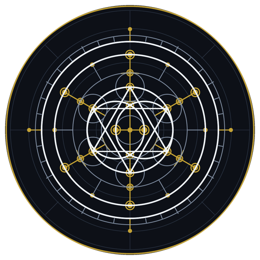
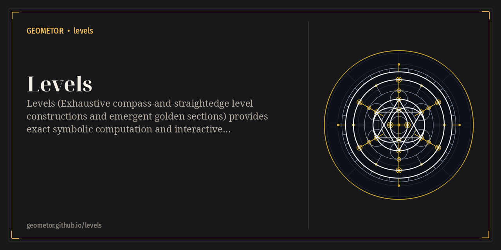

GEOMETOR • levels
=================

**Visit the Online Archive:** https://geometor.github.io/levels/

**Exhaustive compass-and-straightedge level constructions and emergent golden sections.**

Mission
-------

``geometor/levels`` is part of the `GEOMETOR Digital Library <https://geometor.com>`_—providing exact symbolic geometry infrastructure, interactive visualization, and analytical tooling across the GEOMETOR ecosystem.

Capabilities & Interactive Docs
-------------------------------

- `Online Documentation & API <https://geometor.github.io/levels/>`_ — Architecture, usage guides, demos, and module reference.

Repository Contents
-------------------

- ``src/geometor/levels/`` — Core Python 3.13 package implementation.
- ``docsrc/`` — Sphinx documentation source compiled by `PHOTON publish <https://github.com/photon-platform/publish>`_.
- ``tests/`` & ``demos/`` — Automated verification suite and runnable examples.

Local Build & Verification
--------------------------

.. code-block:: bash

   publish build
   uv run --no-sync pytest
   ruff check src tests demos

Part of the GEOMETOR Digital Library
------------------------------------

Explore all **Digital Editions** and **Catalogs** at https://geometor.com/books/.

