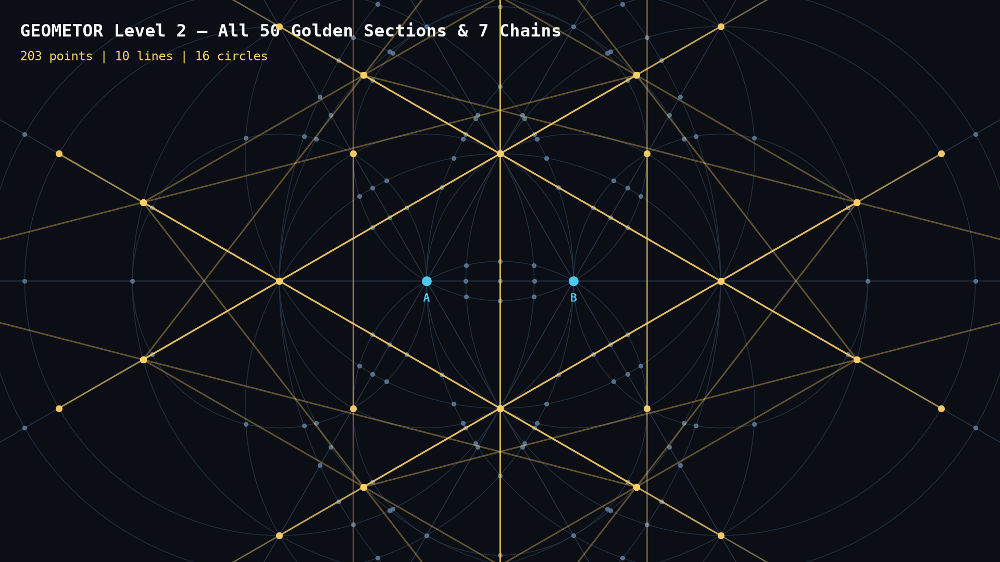
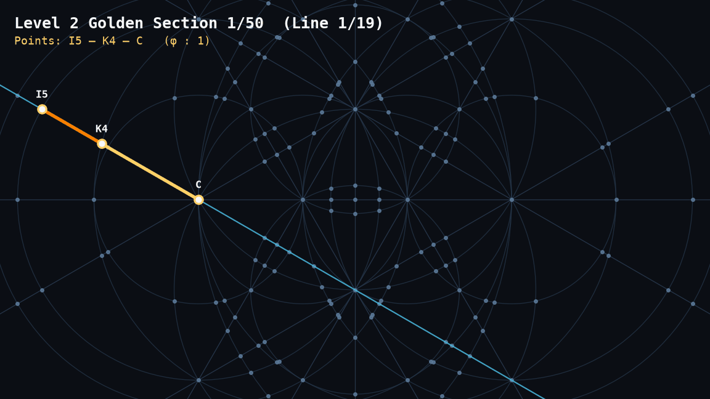
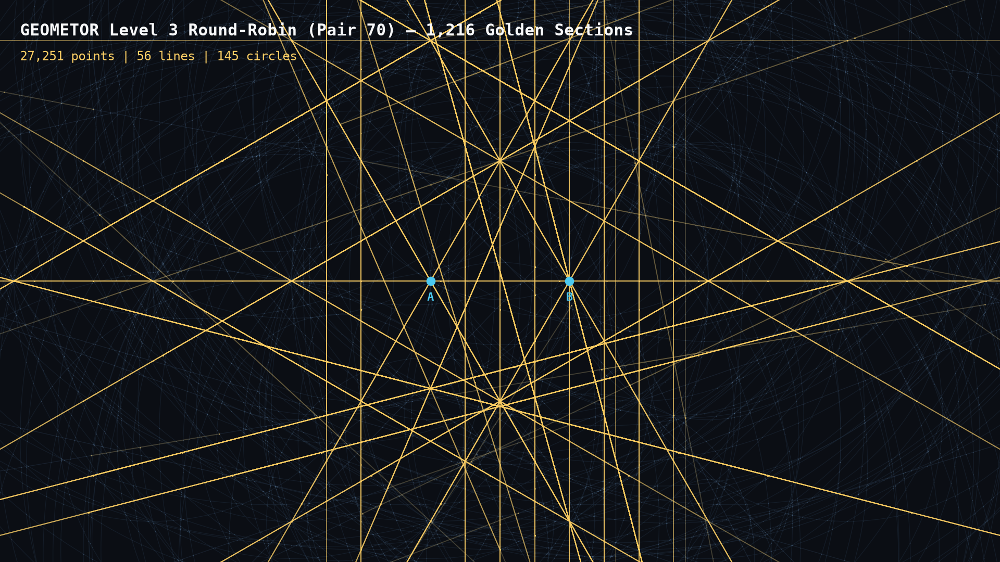
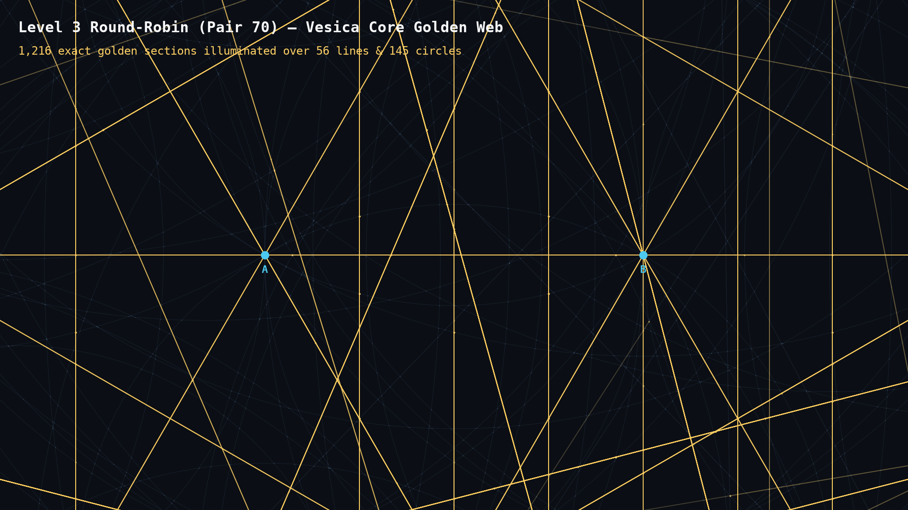
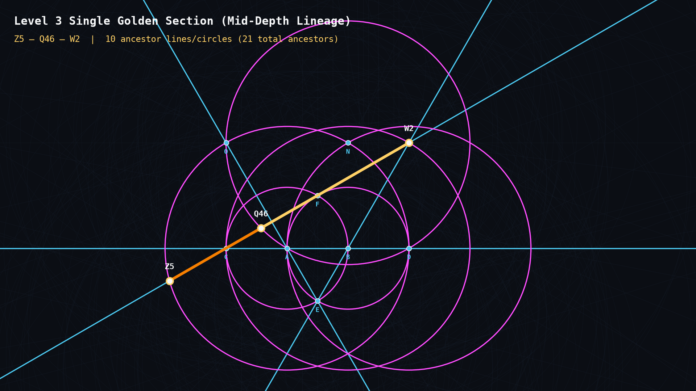
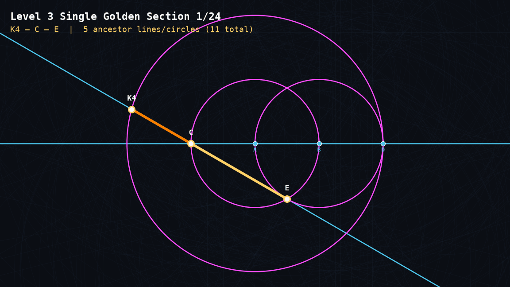

:type: book
:navigation: header
:order: 3
:nav_title: Approaches
:layout: book
:author: phi ARCHITECT
:year: 2026
:excerpt: Constructive depth stratification, pair-closure algorithms, and golden-section discoveries across Euclidean Levels 0–3.

=========================
Approaches & Discoveries
=========================

Starting from two given points :math:`A = (-1/2, 0)` and :math:`B = (1/2, 0)`, each **Level** applies the three fundamental Euclidean operations—one line :math:`[P\,Q]` and two circles :math:`(P\,Q)` and :math:`(Q\,P)`—to every unordered pair of points constructed so far, collecting all new exact symbolic intersections (see :doc:`../levels/index` for the formal hierarchy and interactive SVG explorers).

Totals Summary
==============

.. list-table:: Exact Counts & Milestones Across Levels 0–3
   :header-rows: 1
   :widths: 28 10 14 10 10 14 14

   * - Stage / Run
     - Pairs
     - Points
     - Lines
     - Circles
     - Golden Sections
     - Chains (Max)
   * - **Level 0** (Given)
     - —
     - 2
     - 0
     - 0
     - 0
     - 0
   * - **Level 1** (Full)
     - 1
     - 6
     - 1
     - 2
     - 0
     - 0
   * - **Level 2** (Full)
     - 15
     - 203
     - 10
     - 16
     - **50** (34 explicit)
     - **7** (max 4)
   * - **Level 3** (All Structures)
     - 20,503
     - *~100M+ proj.*
     - **17,562**
     - **32,719**
     - —
     - —
   * - **L3 A-First** (Pair 120)
     - 120
     - 28,641
     - 74
     - 162
     - **3,072**
     - **1,354** (max 17)
   * - **L3 Round-Robin** (Pair 70 / 75)
     - 70 / 75
     - 27,251 / 31,294
     - 56 / 60
     - 145 / 155
     - **1,216** / **1,293**
     - up to 76 / line
   * - **L3 Round-Robin** (Pair 103 / 126)
     - 103 / 126
     - 55,060 / 84,439
     - 70 / 88
     - 211 / 257
     - **1,439** (45/70 lines)
     - **445** (max 10)
   * - **L3 Full Lines** (Lines 0–3)
     - —
     - 31,627 / 58,650
     - —
     - —
     - —
     - —

Level 2: Spontaneous Golden Symmetry
====================================

At Level 2 (15 pairs from 6 Level-1 points), **50 exact golden sections** and **7 golden chains** (including 5 chains of 4 consecutive sections / 6 collinear points) emerge across 8 distinct scales with zero targeting of :math:`\varphi`.

   All 50 exact golden sections and 7 chains across Level 2 (203 points, 10 lines, 16 circles).

   Walking animation cycling through all 50 golden sections line-by-line, followed by the 7 golden chains.

Level 3: Traversal Strategies
=============================

Because :math:`\binom{203}{2} = 20{,}503` pairs generate **17,562 unique lines** and **32,719 unique circles** (**~2.37 billion** pairwise intersection slots), the order in which pairs are traversed dramatically shapes early structure:

1. **Sequential ``A``-First** (``itertools.combinations``)
   Pairs ``A`` with all 202 other points first (pairs 1–202), producing a dense radial starburst through ``A``. At pair 120 (0.585%), a single ray through ``A`` already hosts **9 branching length-17 golden chains** (19 collinear points in consecutive :math:`\varphi`-progression).

2. **Symmetric Radial Interleave** (``order_pairs_symmetric``)
   Orders pairs radially outward from the vesica center ``(0, 0)``, growing both ``A`` and ``B`` together. By pair 76 it reaches **20,635 points**—nearly double the early density of ``A``-first.

3. **Round-Robin Stride Interleave** (``order_pairs_round_robin``)
   Emits ``(P0, P1), (P1, P2), (P2, P3), ...`` across all 203 points, touching every Level-2 point within the first 203 pairs. At pair 70 it yields **27,251 points** and **1,216 tracked golden sections** (up to 76 sections on a single line); by pair 126 it reaches **84,439 points**.

   Round-Robin Pair 70 (27,251 points, 56 lines, 145 circles) with 1,216 exact golden sections illuminated.

   Zoomed-in view of the symmetric golden web between :math:`A = (-1/2, 0)` and :math:`B = (1/2, 0)`.

Direct-Parent Ancestor Isolation
================================

To reveal the minimal compass-and-straightedge origin of each golden section :math:`(P, Q, R)`, we isolate **only the direct first-birth parents** (the 3–6 lines and circles that intersect at :math:`P, Q, R`) in solid cyan while dimming the surrounding Level-3 field.

   Single Level-3 golden section ``N11 — F26 — H26`` with its 5 direct parent lines and circles framed in cyan.

   Cycle of 24 single Level-3 golden sections with their direct parent lines and full parent circles framed.

Algorithmic & Parallel Architecture
===================================

* **Exact :math:`O(1)` Point Deduplication** (``geometor.model`` ``v0.6.1``): :math:`3 \times 3` spatial grid hash (``h = 1e-6``) screens candidates with ``zero_test`` *before* running ``clean_expr``, preventing :math:`O(N^2)` blowups.
* **Fast Golden Search & Point-Birth Impact** (``geometor.divine`` ``v0.4.5``–``v0.4.6``): ``bisect_left`` 1D projection search (:math:`O(n^2 \log n)`) and incremental ``GoldenFieldTracker`` (:math:`O(m \log m)` per new point).
* **Out-of-Core Parallel Level 3** (``geometor.levels.parallel_l3``): 3D spatial grid dedup builds all 50,281 unique Level-3 structures in **111.5s** (14.6× faster than linear dedup). Intersecting single full Level-3 lines against all 50,280 structures reveals **31,627 points** on ``line 0`` and **58,650 points** each on ``lines 1–3``.
