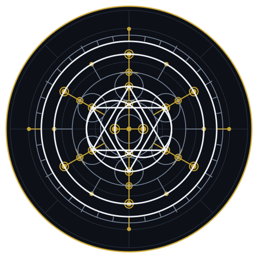

.. container:: author-overline

   semantic digital archive • symbolic module

======
Levels
======

.. include:: intro.rst

.. container:: home-book-hero

   .. container:: home-book-thumb

      .. image:: _static/svg/l2/l2_overview.svg
         :alt: Level 2 Overview

   .. container:: home-book-body

      **Levels (L₀ → L₁ → L₂ → L₃)**

      Formal definition of the iterative Euclidean closure from two seed points
      :math:`A` and :math:`B`, combinatorial growth tables, and interactive
      pan/zoom SVG explorers for Level 1, Level 2 (34 golden sections), and
      Level 3 recursive ancestor trees.

      .. container:: home-actions

         :doc:`Open Levels <levels/index>`
         :doc:`Level 2 Explorer <levels/02-level-2/index>`
         :doc:`Level 3 Ancestors <levels/03-level-3/index>`

.. container:: home-book-hero

   .. container:: home-book-thumb

      .. image:: _static/svg/rr/pair_12/overlay.svg
         :alt: Round Robin Pair 12 Overlay

   .. container:: home-book-body

      **Round Robin Pairs (06–70)**

      Step-by-step progression through all 65 active Level 3 round-robin
      pairs from **Pair 06 (F — G)** to **Pair 70 (R3 — S3)**, featuring
      label-free ancestor overlays, scale-count breakdowns, and individual
      golden section proofs.

      .. container:: home-actions

         :doc:`Explore Pairs <round-robin/index>`

.. container:: home-book-hero

   .. container:: home-book-thumb

      .. image:: _static/svg/l3/l3_01.svg
         :alt: Level 3 Ancestor Tree

   .. container:: home-book-body

      **Approaches & Discoveries**

      Comparative benchmarks and milestone counts across sequential,
      round-robin interleaved, :math:`A`-first, full-line, and parallel
      ray-level intersection strategies for pushing into the Level 3 frontier.

      .. container:: home-actions

         :doc:`Read Approaches <approaches/index>`

.. toctree::
   :maxdepth: 2
   :hidden:

   levels/index
   round-robin/index
   approaches/index
